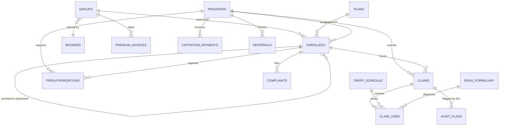

# Nigerian Health Insurance (HMO) Synthetic Dataset Suite

A realistic, production-grade synthetic data generator modeling the operational, clinical, and financial ecosystem of a Nigerian Health Maintenance Organisation (HMO).

Built for data engineering, actuarial analysis, healthcare billing analytics, Special Investigation Unit (SIU) fraud detection, and analytical data warehouse benchmarking.

---

## 1. Architecture & Entity-Relationship Model

The ecosystem models **16 interconnected relational tables** with strict foreign key integrity, mirroring the real-world operational workflows of Nigerian private and public health insurance.



---

## 2. Table-by-Table Data Dictionary

### Core Entities
1. **`enrollees`**: Enrollee master file.
   - `enrollee_id`: Unique identifier (`ENR-xxxxxxx`).
   - `principal_flag`: 1 if principal, 0 if dependant.
   - `principal_id`: Foreign key pointing to principal enrollee (`NULL` for principals).
   - `relationship`: `PRINCIPAL`, `SPOUSE`, or `CHILD`.
   - `dob`: Date of birth (reflects Nigeria's youth demographic pyramid).
   - `sex`: `M` or `F`.
   - `state` / `lga`: Nigerian state and Local Government Area (LGA).
   - `scheme_type`: `Formal Sector Private`, `Formal Sector Public`, `Informal / Voluntary Retail`, `State-Sponsored Equity`, or `BHCPF`.
   - `group_id`: Foreign key to `groups` (`NULL` for retail).
   - `plan_id`: Foreign key to `plans`.
   - `primary_care_provider_id`: Foreign key to `providers`.
   - `enrolment_date`: Enrolment effective date.
   - `status`: `Active`, `Suspended`, or `Terminated`.
   - `nin`: 11-digit National Identity Number.
   - `phone_number`: Nigerian phone number (`+234-...`).

2. **`groups`**: Corporate and government client organizations.
   - `group_id`, `name`, `sector`, `headcount`, `contract_start`, `contract_renewal`, `broker_id`, `negotiated_premium_head`.

3. **`plans`**: HMO benefit plan tiers.
   - `plan_id`: `PLN-BRZ-01`, `PLN-SLV-02`, `PLN-GLD-03`, `PLN-PLT-04`, `PLN-ST-EQ-05`.
   - `tier`: Bronze, Silver, Gold, Platinum, State Equity/BHCPF.
   - `premium_per_head`, `annual_limit`, `co_pay_pct`, `waiting_periods`, `exclusions`, `referral_rules`.

4. **`providers`**: Network healthcare facilities across Nigeria.
   - `provider_id`, `name`, `level` (`Primary`, `Secondary`, `Tertiary`), `ownership` (`Private`, `Public`, `Faith-based`), `state`, `lga`, `specialties`, `accreditation_status`, `contract_type` (`Capitation`, `Fee-For-Service`).

5. **`brokers`**: Licensed insurance brokers placing group accounts.
   - `broker_id`, `name`, `commission_rate` (7.5% – 12.5%), `license_number` (NAICOM), `state`.

### Reference Tables
6. **`tariff_schedule`**: Agreed procedure, consultation, bed-day, and diagnostic fees.
   - `tariff_id`, `service_code`, `service_type`, `description`, `facility_level`, `tariff_year` (2023, 2024, 2025), `price_ngn`, `effective_date`.
7. **`drug_formulary`**: Essential medicines list.
   - `drug_id`, `brand_or_label`, `generic_name`, `dosage_form`, `unit_price_ngn`, `is_covered`, `requires_preauth`.
8. **`icd10_subset`**: Clinical ICD-10 diagnostic definitions with Nigerian epidemiological weights.
   - `icd10_code`, `description`, `category`, `base_weight`, `sex_restriction`, `min_age`, `max_age`, `severity`, `is_rainy_seasonal`.

### Transactions
9. **`premium_invoices`**: Monthly corporate billing records.
   - `invoice_id`, `group_id`, `period` (`YYYY-MM`), `amount_billed`, `amount_paid`, `payment_date`, `arrears`, `payment_channel` (NIBSS, Remita, Direct Debit), `status`.
10. **`capitation_payments`**: Monthly capitation disbursements to Primary Care Providers.
    - `capitation_id`, `provider_id`, `month`, `enrollees_assigned`, `rate_per_head`, `total_amount`, `payment_date`, `status`.
11. **`preauthorizations`**: Pre-authorization requests for secondary/surgical/imaging interventions.
    - `auth_id`, `enrollee_id`, `provider_id`, `requested_service`, `icd10_code`, `requested_amount`, `approved_amount`, `status`, `turnaround_hours`, `denial_reason`, `request_date`, `decision_date`.
12. **`claims`**: Encounter headers.
    - `claim_id`, `enrollee_id`, `provider_id`, `encounter_type` (`Outpatient`, `Inpatient`, `Emergency`, `Maternity`), `admission_date`, `discharge_date`, `primary_icd10`, `secondary_icd10`, `submission_date`, `batch_id`, `total_billed`, `total_approved`, `total_paid`, `status`, `rejection_reason`, `adjudication_date`, `payment_date`.
13. **`claim_lines`**: Itemized encounter charges.
    - `line_id`, `claim_id`, `line_type` (`consultation`, `lab`, `imaging`, `drug`, `procedure`, `bed-day`), `service_code`, `description`, `quantity`, `unit_price`, `billed_amount`, `approved_amount`.
14. **`referrals`**: Formal gatekeeper transfers to secondary/tertiary hospitals.
    - `referral_id`, `enrollee_id`, `from_provider_id`, `to_provider_id`, `reason`, `referral_date`, `status`.

### Operations & Risk
15. **`complaints_tickets`**: Customer service tickets.
    - `ticket_id`, `enrollee_id`, `provider_id`, `category` (demanded out-of-pocket, drug refusal, delayed auth, wrong PCP), `status`, `priority`, `opened_date`, `resolved_date`, `resolution_notes`.
16. **`audit_flags`**: Special Investigation Unit (SIU) fraud, waste, and abuse alerts.
    - `flag_id`, `claim_id`, `flag_type` (upcoding, impossible gender diagnosis, duplicate billing, post-discharge service, unbundled lab panels), `severity`, `detection_rule`, `amount_at_risk`, `investigation_outcome`, `flagged_date`.

---

## 3. Nigerian Demographic & Realism Levers

- **Demographics**: Authentic Nigerian given names and surnames sampled across Yoruba, Igbo, Hausa/Fulani, South-South, and Middle-Belt ethnolinguistic groups.
- **Geography**: Concentration matches real-world private insurance distribution: Lagos (41.4%), FCT Abuja (17.8%), Rivers / Port Harcourt (9.8%), Oyo / Ibadan (6.0%), Kano (5.2%), and other states (19.8%).
- **Epidemiology & Seasonality**:
  - *Malaria* (`B50.9`) accounts for 45% of clinical encounters, surging significantly during the West African rainy season (May through October).
  - *Acute Upper Respiratory Infections* (`J06.9`) peak during the dry Harmattan season (December to February).
  - High-acuity conditions (Sickle Cell disease crisis `D57.0`, trauma/RTAs `V89.2`, emergency caesarean section `O82`) drive catastrophic surgical spend.
- **Financial Dynamics**:
  - Denominated in Nigerian Naira (NGN).
  - Heavy-tailed spend: Routine OPD claims range from ₦3,500 to ₦25,000, while catastrophic inpatient/surgical care ranges from ₦350,000 to ₦2,500,000+.
  - Multi-year tariff drift captures local medical inflation (+18% to +22% annually).
- **Process Friction**:
  - Encounters batched monthly by hospitals with 15–45 day reporting lags.
  - HMO adjudication and payment lags between 30 and 90 days.
  - Steady ~8% claim rejection rate and ~8% tariff deductions.
  - Injected audit anomalies for SIU compliance and fraud detection modeling.

---

## 4. Dataset Generation Metrics (Full Scale)

The generation suite produces **1,514,819 records** in ~80 seconds (~18,000+ rows/second throughput):

| Table | Records | Purpose |
| :--- | :--- | :--- |
| `claim_lines` | 964,923 | Itemized billings |
| `claims` | 260,000 | Encounter headers |
| `enrollees` | 100,000 | Enrollee master file |
| `referrals` | 57,604 | Provider referral letters |
| `capitation_payments` | 50,040 | Monthly capitation disbursements |
| `audit_flags` | 22,000 | SIU forensic audit alerts |
| `preauthorizations` | 21,899 | Pre-authorization records |
| `premium_invoices` | 18,000 | Corporate monthly invoices |
| `complaints_tickets` | 18,000 | Enrollee customer tickets |
| `providers` | 1,500 | Healthcare facilities |
| `groups` | 500 | Client organizations |
| `tariff_schedule` | 189 | Tiered tariff price book |
| `brokers` | 120 | Insurance brokers |
| `drug_formulary` | 23 | Essential medicines |
| `icd10_subset` | 16 | Clinical diagnoses subset |
| `plans` | 5 | HMO plan tiers |
| **TOTAL** | **1,514,819** | **Full Relational Ecosystem** |

---

## 5. Usage & Commands

### Running Generation
```bash
# Full generation (1.5M+ records, exports to nigerian_hmo.db and data/*.csv)
python3 generate.py --scale full --seed 42

# Fast sample generation (~100k records for rapid prototyping)
python3 generate.py --scale sample --seed 42 --db-path sample_hmo.db --csv-dir sample_data
```

### Running Verification & Audits
```bash
python3 verify_data.py --db-path nigerian_hmo.db
```

### Running Unit Tests
```bash
python3 -m unittest discover -s tests -v
```

---

## 6. Day-0 Enrollee Risk Engine & Intake Scoring

Predicts expected Year-1 claims cost, catastrophic hospital admission probability, risk tiering, and actionable underwriting recommendations at onboarding:

### Training the Risk Model
```bash
python3 train_risk_model.py --db-path nigerian_hmo.db --out-weights models/risk_model_weights.json
```

### Scoring an Onboarding User in Real-Time
```bash
python3 predict_risk.py \
  --age 28 \
  --sex F \
  --state Lagos \
  --relationship PRINCIPAL \
  --sector "Banking & Financial Services" \
  --tier "Gold / Comprehensive" \
  --copay 0.0
```

### JSON Mode (for API integration)
```bash
python3 predict_risk.py --age 52 --sex M --state Rivers --scheme "Informal / Voluntary Retail" --json
```
